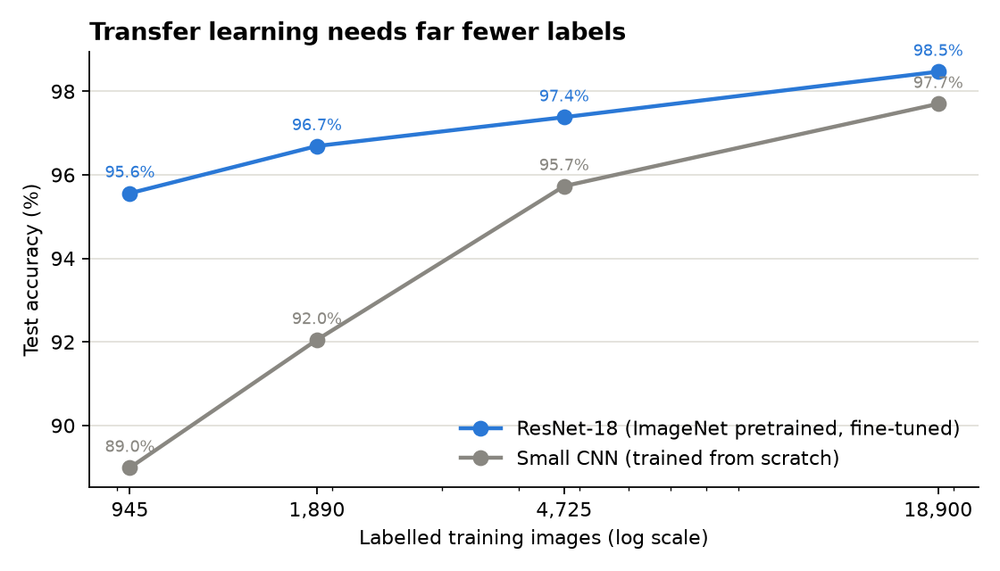
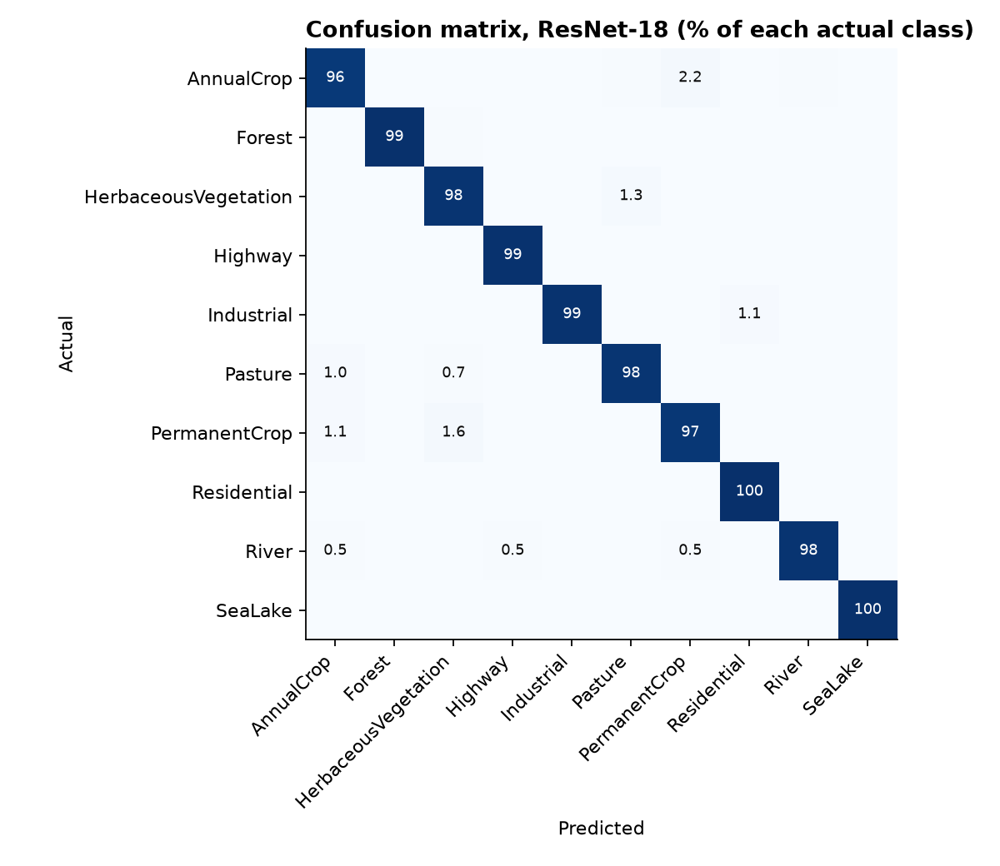
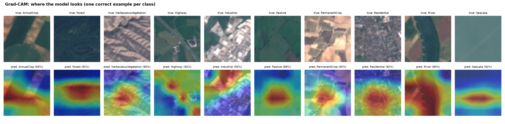
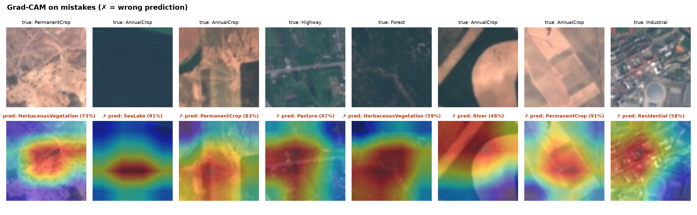
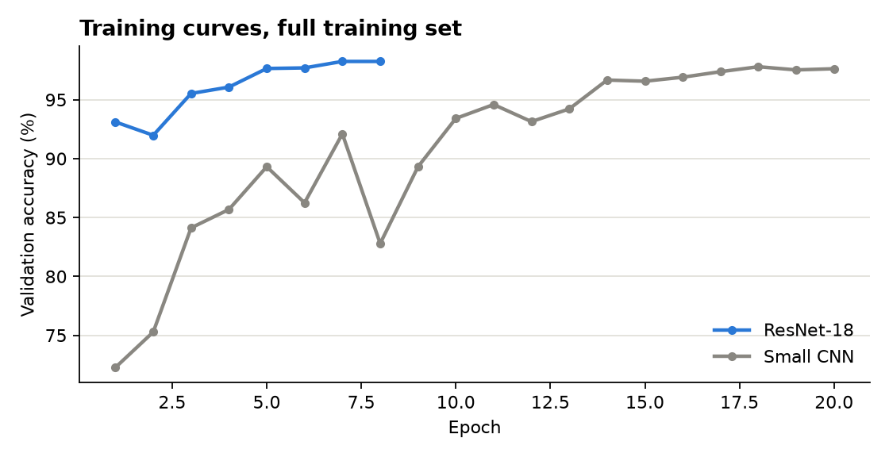

# Satellite Land-Use Classification with Deep Learning

Classifying Sentinel-2 satellite images into 10 land-use types (crops, forest, highway, river, residential, ...) with PyTorch. The project compares a CNN trained from scratch with a fine-tuned pretrained ResNet-18, measures **how many labelled images each one needs**, and uses **Grad-CAM** to check what the model is looking at.

   



## Why this matters

Land-use maps are used for crop monitoring, urban planning, insurance and environmental reporting. Labelling satellite images is slow and expensive, so the useful business question is not only "how accurate?" but also **"how many labels do we need?"**

## Data

[EuroSAT](https://github.com/phelber/EuroSAT) (RGB version): 27,000 image patches of 64x64 pixels (10 m per pixel) from the Sentinel-2 satellite, 2,000-3,000 per class. Split once into 70% train / 15% validation / 15% test, stratified by class with a fixed seed and saved to `data/splits.csv`, so every model is tested on exactly the same 4,050 images.

## Results

Test accuracy on 4,050 held-out images:

| Labelled training images | Small CNN (from scratch, 1.2M params) | ResNet-18 (pretrained, 11.2M params) |
|---|---|---|
| 945 (5%) | 89.0% | **95.6%** |
| 1,890 (10%) | 92.0% | **96.7%** |
| 4,725 (25%) | 95.7% | **97.4%** |
| 18,900 (100%) | 97.7% | **98.5%** (macro F1 0.984) |

**Key findings**

1. **Transfer learning cuts the labelling need about 5x.** ResNet-18 with 945 labelled images (95.6%) matches the from-scratch CNN with 4,725 images (95.7%).
2. **With all data, the gap is smaller but real:** 62 errors vs 93 for the CNN, i.e. one-third fewer mistakes.
3. **Training is cheap:** the best model trains in under 9 minutes on a laptop GPU (Apple M2).
4. **Errors make sense.** The most common confusions are between visually similar farmland classes: AnnualCrop ↔ PermanentCrop (14 of 62 errors) and HerbaceousVegetation ↔ Pasture / PermanentCrop. Residential and SeaLake are near-perfect.



## Is the model looking at the right thing? (Grad-CAM)

Grad-CAM highlights the image regions that drove each prediction. For correct predictions the model focuses on the river channel, the road, the built-up area, the field boundaries:



On mistakes, the heatmaps show *why* it went wrong. For example, a uniformly dark crop field is called "SeaLake", and a thin road through fields is called "Pasture": the road is only a few pixels wide and the heatmap spreads over the surrounding grass:



Note: confidences top out around 90-93% because training uses label smoothing (0.1), which keeps the model from being over-confident.

## Method

- **Augmentation:** flips, 90° rotations and light colour jitter. Satellite images have no "up", so every rotation is a valid view.
- **Small CNN:** 4 conv blocks (32-64-128-256 filters, batch norm), global average pooling, dropout. Trained at the native 64 px.
- **ResNet-18:** ImageNet weights, new classification head, all layers fine-tuned. Images upscaled to 128 px so the last layer keeps a 4x4 spatial map (useful for Grad-CAM).
- **Training:** AdamW, one-cycle learning-rate schedule, label smoothing, best epoch chosen on validation accuracy (the test set is used once at the end).
- **Fair data-efficiency test:** the smaller training sets are stratified subsets, and they get more epochs so every run sees enough updates.



## How to run

```bash
python -m venv .venv && source .venv/bin/activate
pip install -r requirements.txt
python -m src.train --model resnet18 --epochs 8   # downloads EuroSAT (~90 MB), trains one model
python scripts/run_experiments.py                 # all 8 runs for the data-efficiency chart (~40 min on M2)
python -m src.evaluate                            # metrics.json + figures
pytest -q                                         # 5 tests
```

Runs on Apple Silicon (MPS), NVIDIA (CUDA) or CPU.

## Project structure

```
├── src/data.py              # download, fixed stratified split, augmentation, data loaders
├── src/models.py            # small CNN, ResNet-18 with new head
├── src/train.py             # training loop, checkpointing, test metrics per run
├── src/gradcam.py           # Grad-CAM from scratch with forward/backward hooks
├── src/evaluate.py          # confusion matrix, Grad-CAM figures, metrics.json
├── scripts/run_experiments.py
├── tests/                   # model shapes, Grad-CAM, stratified sampling
└── reports/                 # metrics.json, per-run results, figures
```

## Limitations and next steps

- RGB only: EuroSAT also has 13 multispectral bands (e.g. near-infrared), which usually help separate crop types.
- One seed per run; repeating with several seeds would give error bars on the data-efficiency curve.
- Next: try EfficientNet / ViT backbones and test on images from a different country to measure geographic drift.
